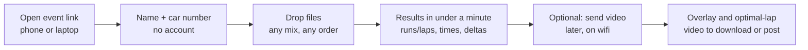
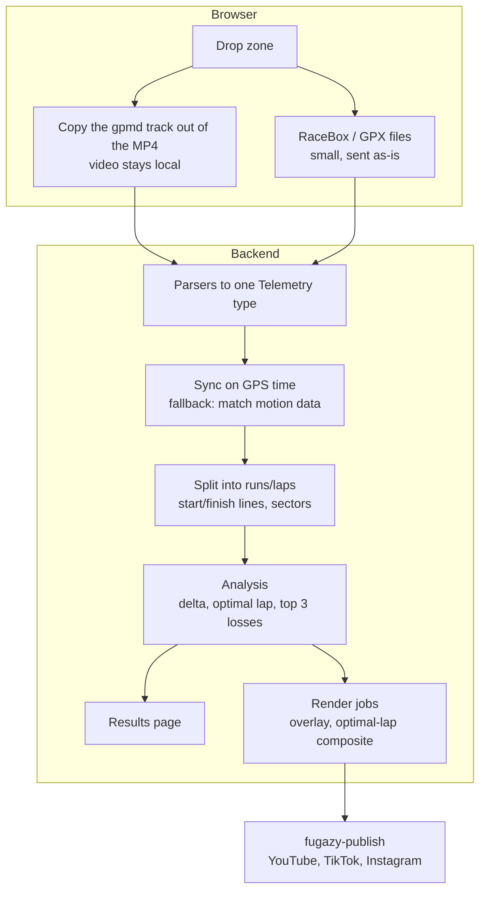
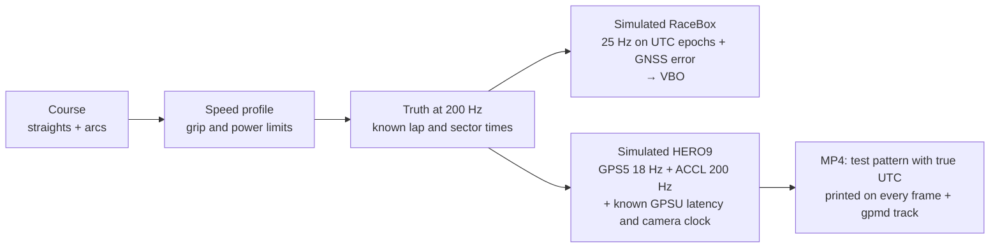

# fugazy-delta build plan

A hosted web app for autocross (CVSCC) and track days (RevMatch, Chin Track
Days): a driver drops in the files from a RaceBox Mini and a GoPro and gets
their runs or laps, the time delta between them, an optimal lap, the three
places they lose the most time, and an overlay video. That covers Garmin
Catalyst's post-session features; live audio coaching is out of scope.

The author (Isaac) runs a RaceBox Mini and a GoPro HERO9 in a Miata. The plan
works backwards from the upload, because whether anyone besides the author
uses the app depends on how easy the upload is.

## 1. What the user does

Rules that keep it simple:

- **No "pick your device" step.** The app identifies each file itself: GoPro
  MP4, RaceBox VBO or CSV, GPX.
- **No manual sync.** GoPro and RaceBox are aligned on GPS time.
- **No course drawing.** Track days match a library of known tracks by GPS.
  At an autocross the organiser sets start and finish once per event, or
  they are inferred from where every driver's runs begin and end.
- **Results do not wait for video.** Times, deltas and the optimal lap come
  from telemetry alone; video is an add-on.
- **Location data:** one consent line at upload, a delete button on every
  session, nothing sold or shared.

### The GoPro file is the hard part

A GoPro chapter is up to 4 GB; nobody uploads that over a cell connection
from a paddock. The telemetry inside it is a few MB. So the browser pulls
only the telemetry track out of the MP4 and uploads that; the video stays
on the user's device until they choose to send it for rendering.

| Device | How the file reaches the app | Friction |
|---|---|---|
| RaceBox Mini | Phone app syncs to racebox.pro; export VBO or CSV from the session page | Low. No public cloud API, so no account linking |
| GoPro HERO9 | SD card into a laptop, or the Quik app on a phone | Highest, so test with real people first |
| Phone only | GPX from any lap-timer app | Low, lower quality |

Before any backend work, a clickable prototype on fake data goes in front
of 3–5 people at an event, to see where the GoPro step loses them.

## 2. The system

The browser does one thing — copy the telemetry bytes out of the MP4 — and
all parsing happens in Python on the backend, so there is one parser and
one test suite.

| Component | Job | Build or reuse |
|---|---|---|
| Browser extraction | Copy the `gpmd` track out of a multi-GB MP4 without reading the whole file | Reuse mp4box.js; **spike** on a 4 GB file |
| Parsers | GoPro GPMF (GPS5, ACCL, GYRO), RaceBox VBO and CSV, GPX → `Telemetry` | GPMF and VBO done in phase 0; CSV and GPX to do |
| Sync | Align devices on GPS time; handle chaptered GoPro files; fall back to matching motion data | Build |
| Fusion | Prefer RaceBox 25 Hz position; use GoPro GPS when there is no RaceBox | Build |
| Segmentation | Start/finish crossings, sectors, staging, out- and in-laps | Build |
| Track library | Start/finish and sector lines for the tracks the user runs | Build, starting with the user's tracks |
| Analysis | Speed against distance, delta-t, minimum corner speeds, braking points, distance-based mini-sectors | Build |
| Optimal lap | Best mini-sector from each lap, **only from lines driven more than once**, so the result is achievable | Build |
| Top 3 losses | The sectors losing the most against your own best, with run-vs-run clips | Build |
| Overlay render | Speed, g-circle, map, delta burned into video | Reuse `gopro-overlay` as a base (check licence first) |
| Composite video | Cut the best segments from several laps together with a running combined time | Build on ffmpeg |
| Publish | Hand the finished video to `fugazy-publish` | Exists; its Flox environment is in progress |
| Environment | One Flox environment for development, CI and the render worker; `flox containerize` for deploy | Flox |

### HERO9 specifics

The author's camera is a HERO9 Black. It writes GPS5 at ~18 Hz (lat, lon,
alt, 2D speed, 3D speed), ACCL and GYRO at ~200 Hz, and **one** GPSU UTC
timestamp per ~1 s payload. The 18 GPS samples in a payload have no
timestamps of their own: readers spread them evenly over the payload's
duration from the MP4 sample table. Sync therefore depends on

1. GPSU being accurate to the payload, and
2. the even-spread assumption holding within the payload.

GoPro's GPS timestamps may also lag the position they label (community
reports; unverified). So the sync stage measures the GoPro's
offset against the RaceBox (whose 25 Hz samples each carry their own UTC
time) rather than trusting GPSU, and the virtual-car tests inject a known
GPSU latency (`CameraClock.gpsu_latency`) so that stage can be checked
against a known answer. The camera's own clock, written as MP4
`creation_time`, is not trusted for anything.

GoPro's public sample files stop at the HERO8, which writes the same GPS5
stream. One real HERO9 clip from the author's camera becomes a fixture as
soon as it exists.

## 3. Testing without the hardware

Four layers:

1. **Real files.** GoPro's `gpmf-parser` samples (HERO5, HERO6, HERO8),
   fetched and checksum-pinned by `scripts/fetch-fixtures.sh`. For the
   RaceBox, one real VBO and CSV export from a club member gives the true
   column layout.
2. **Virtual car with known answers.** Because the truth is known, tests
   assert exact outcomes:
   - sync recovers the injected GoPro offset to within one video frame
   - lap and run times within ±0.01 s of truth
   - optimal lap equals the sum of the best sectors, built in on purpose:
     for example, lap 2 has the best sector 1 and lap 3 the best sector 2
   - the overlay on the frame stamped *t* shows the truth at *t*
3. **Messy data.** GPS dropouts, no fix at the start, a recording split
   across two chapters, truncated files, drifting clocks, the wrong file
   type, a red-flagged lap, an autocross DNF or rerun.
4. **Bluetooth emulator (later).** An open-source ESP32 RaceBox Mini
   emulator speaks RaceBox's published BLE protocol, if live import is ever
   added. Not in v1.

## 4. Phases

| Phase | Delivers | Hardware needed |
|---|---|---|
| 0. Foundations | Flox environment, `Telemetry` model, virtual car, VBO and GPMF codecs, synthetic GoPro MP4 (works; see `docs/spikes/gpmf-mux.md`), CI, clickable prototype tested on real people | None |
| 1. Autocross results | Upload → runs, times, run-vs-run delta, from telemetry only. **The demo for the sponsorship proposal** | None |
| 2. Track days | Track library, laps, sectors, optimal lap time | None |
| 3. Video | Overlay render, optimal-lap composite video, top 3 losses | RaceBox and GoPro (arriving next year) |
| 4. Event mode | Organiser page for CVSCC with every driver's results; hand-off to `fugazy-publish` | — |

Phases 0–2 need no hardware, so they can be done before the 2027 season.

## 5. Decisions

| Decision | Choice |
|---|---|
| Hosted or local | Hosted, with telemetry extraction in the browser |
| Repository | New repo `fugazy-delta`. `fugazy-publish` stays the final step and gets its own Flox environment, while keeping its native Windows path |
| Camera | GoPro HERO9 Black (GPS5). The HERO12 has no GPS; avoid it |
| Location data | Consent line and delete button from the first version |

## 6. Open risks

- **Browser extraction from a 4 GB file** — mp4box.js must read the `moov`
  without loading the whole file. Spike before phase 1 depends on it.
- **Getting files off the GoPro** — the prototype test decides whether phone upload
  is viable or the laptop is the path.
- **RaceBox export columns** — the VBO reader matches columns by name; the
  names RaceBox actually uses are unconfirmed until a real export is in hand.
- **GoPro accelerometer axes** — assumed `ORIN "ZXY"` with a forward-facing
  level camera. Verify on a real mounted clip before the fallback that syncs
  devices by matching motion data relies on it.
