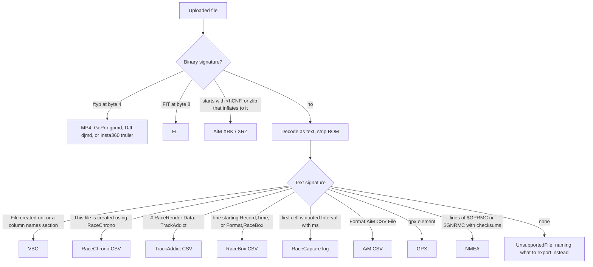

# Import formats: which devices, which files, in what order

fugazy-delta should time every driver at an event the same way, whatever
recorded them. That means reading the files that drivers' lap timers and
data loggers already produce. This document lists the devices US amateur
autocross, HPDE and time-attack drivers use, what each one exports, how
each format is specified, where real sample files exist, and the order
in which to build importers. It was researched in October 2026. The
importers in recommended-order items 1–8 of section 7 are now built;
PLAN.md section 7 records their status, the accuracy profile each device
quotes, and why the rest are not done.

**Recommendation:** the first three importers to build are fixes to
the VBO reader, RaceBox CSV and RaceChrono CSV v3. Together they cover
the author's RaceBox Mini and the most-used phone app. VBO alone is exported
by six of the popular devices and apps. The reader in `vbo.py` has two
bugs that real files expose (section 6.1), so that work comes first.

## 1. What people use

The five most-used devices and apps are RaceChrono, AiM Solo 2,
TrackAddict, Garmin Catalyst and RaceBox; the table gives the evidence
for each. Reddit could not be fetched by any research tool (blocked), and
Grassroots Motorsports (GRM) pages returned 403 to plain fetches. Reddit
claims below are therefore from search snippets and are marked as such.
GRM pages were read through a browser. App install counts are the
Google Play install bands and US App Store rating counts on 2026-10-20.

| Rank | Device or app | Evidence |
|---|---|---|
| 1 | RaceChrono Pro (phone app, usually with an external GPS such as a RaceBox Mini) | Free app 500K+ Play installs, Pro 10K+; the App Store page claims "over 100000 active users" ([App Store](https://apps.apple.com/app/id1129429340)). An instructor on CorvetteForum recommends RaceChrono plus external GPS as the first setup ([thread](https://www.corvetteforum.com/forums/autocrossing-and-roadracing/4927184-track-times-data-logging-video-setup-c6-zo6.html)) |
| 2 | AiM Solo 2 / Solo 2 DL (MyChron for karts) | NASA Speed News calls the Solo 2 "the most popular entry-level data logger for club racers and NASA drivers" ([article](https://nasaspeed.news/tech/electronics/how-to-choose-your-first-data-system/)). The Apex Pro app added "AiM Solo 2 file import" ([App Store](https://apps.apple.com/us/app/apex-pro-new/id1622912479)) |
| 3 | TrackAddict (HP Tuners), often with RaceRender | 100K+ Play installs; 515 US App Store ratings, plus 269 for the Pro app, the most of any lap-timer app counted here. Seven mentions in GRM's "Turn a smartphone into a data acquisition system" thread ([thread](https://grassrootsmotorsports.com/forum/grm/turn-a-smartphone-into-a-data/274870/page1/)) |
| 4 | Garmin Catalyst / Catalyst 2 | Catalyst app 10K+ Play installs (one app per device, so a rough unit count). NASA Speed News: "probably the easiest way to start using data" (article above). Catalyst 2 launched 2026-02-20 at $1,199.99 with a built-in camera ([AutoGuide](https://www.autoguide.com/auto/garmin-launches-catalyst-2-track-driving-coach-with-built-in-camera-44630233)) |
| 5 | RaceBox Mini / Mini S / Micro | RaceBox app 50K+ Play installs, which includes drag racers. A GRM reader comment reports a Mini's autocross times "within a tenth" of official timing ([GRM](https://grassrootsmotorsports.com/articles/data-autocross/)). A Talladega Autocross Club thread covers setting it up for autocross ([TAC forum](https://teamtac.org/e107/e107_plugins/forum/forum_viewtopic.php?128091=)). r/Trackdays recommends the Mini S (search snippet only) |
| 6 | Harry's LapTimer | 10K+ Play installs for Rookie; 153 App Store ratings for Petrolhead and 81 for Grand Prix. The vendor counts 11.158M laps uploaded ([gps-laptimer.de](https://www.gps-laptimer.de)) |
| 7 | SoloStorm (Android, autocross-specific) | GRM: "most prominently" the autocross-specific suite (article above); eight mentions in the smartphone thread above. solostorm.net now redirects to an unrelated domain, so the product appears to be defunct |
| 8 | GoPro HERO with GPS | Used as the video source for most setups; four mentions in the GRM smartphone thread |
| 9 | Tail | Racelogic VBOX (seen as expensive), Apex Pro (120 + 42 App Store ratings), Dragy and dragy·Lap, LapSnap, AutoSport Labs RaceCapture, Qstarz, DJI and Insta360 cameras with GPS remotes, MoTeC (pro cars and sim racing) |

External Bluetooth receivers such as the Dual XGPS160, Garmin GLO 2, and
a RaceBox used as a phone receiver write no files of their own. They
feed NMEA or a binary protocol to a phone app, raising its rate from
about 1 Hz to 10–25 Hz, and the file the user ends up with is the app's
export.

## 2. What each device exports

Most devices write a UTC time with every sample; AiM CSV, MoTeC and the
date line of Racelogic VBO files are the exceptions. "UTC per sample"
means every sample carries an absolute time and the
file carries the date. Without both, the importer has to infer a time
zone, which section 6.2 covers.

| Device or app | Files the user can get, and how | GPS rate | Channels | UTC per sample? | Source |
|---|---|---|---|---|---|
| RaceBox Mini / Mini S / Micro | Web export at racebox.pro, My Sessions: VBO; CSV with presets (Telemetry Overlay, RaceRenderer, Serious Racing, Custom); GPX and KML with position and time only | 25 Hz; Mini S and Micro can log at 10 Hz to save storage | Position, speed, altitude, accel, gyro; heading in some CSV presets. No CAN or OBD | Yes: ISO 8601 UTC in every CSV row; "UTC Date Started" in the VBO comments | [export page](https://www.racebox.pro/info/session-export), [Mini](https://www.racebox.pro/products/racebox-mini), [Mini S](https://www.racebox.pro/products/racebox-mini-s) |
| RaceChrono Pro | Share sheet: CSV (v2, v3), VBO, NMEA, GPX (v10.2.1+), native .rcz | Phone or external receiver (a real file shows 20 Hz GPS) | GPS, phone IMU, OBD and CAN, calculated channels | Yes: Unix epoch seconds per row | [racechrono.com](https://racechrono.com/), [changelog](https://racechrono.com/article/2025), [how to export](https://racechrono.com/article/faq/how-to-view-my-sessions-on-pc-or-mac) |
| TrackAddict | Share, "Send Data File": CSV, KML, VBO; Wi-Fi or USB transfer | About 1 Hz on phone GPS; rows at 20–50 Hz driven by the accelerometer and OBD | GPS, phone accel, OBD | Yes: `UTC Time` column in epoch seconds | [HP Tuners forum](https://forum.hptuners.com/showthread.php?p=571935), [RaceRender docs](https://racerender.com/RR3/docs/Dataloggers.html) |
| Harry's LapTimer | CSV (export only), VBO, NMEA, GPX, KML, native .hlptrl | 1 Hz phone, about 10 Hz with an XGPS160 | GPS, accel, OBD | Unverified for CSV | Forum threads on gps-laptimer.de, search snippets only; the forum did not load |
| AiM Solo 2 / Solo 2 DL / MyChron 5–6 | .xrk / .xrz / .drk from the logger; "AiM CSV File" export from Race Studio 3, which is Windows-only | 25 Hz GPS, IMU about 50 Hz in a real file | GPS, IMU, ECU over CAN/RS232/K-line on DL models | XRK: yes, GPS week and time of week. AiM CSV: no, local session start only | [AiM store](https://store.aim-sportline.com/en/lap-timers/37-solo-2-dl.html), [libxrk](https://github.com/m3rlin45/libxrk) |
| Garmin Catalyst / Catalyst 2 | No official data export, only MP4 video. Over USB the session data is FIT, which a Rennlist user converted with Garmin's FitCSVTool | Catalyst 10 Hz (snippet); Catalyst 2 outputs a fused 25 Hz | GPS, IMU | Yes, FIT timestamps | [Rennlist](https://rennlist.com/forums/data-acquisition-and-analysis-for-racing-and-de/1325046-garmin-catalyst-technical-hacks.html), [the5krunner](https://the5krunner.com/2026/02/17/garmin-catalyst-fenix-9-gnss/) |
| Racelogic VBOX Sport, LapTimer, Performance Box Touch, Video HD2 | .vbo on SD card (Sport also logs to the iOS app); Circuit Tools exports CSV and KML | 25 Hz (Sport, LapTimer); a real HD2 file is 10 Hz | GPS; accel derived from GPS on Sport, LapTimer and PBT; CAN on HD2 | Time of day in UTC; the date line is local time (section 6.1) | [VBO spec](https://developers.racelogic.co.uk/Portal/Tutorials/tutorialVBOfilestructure.html); Racelogic support pages via the Wayback Machine |
| dragy / dragy·Lap | Main app: no data export ([help article](https://dragymotorsports.help.center/article/1022-can-i-export-data-to-csv-or-similar)). dragy·Lap: VBO export | 25 Hz (DRG69: 10 Hz) | GPS, IMU on Pro, OBD/CAN via dragy·Lap | Presumably VBO time; no sample found | [dragy·Lap App Store](https://apps.apple.com/app/id1617703369) |
| Apex Pro | iOS app CSV ("Improved CSV export to match legacy app format", v1.5.5), AirDrop | 10 Hz | GPS, 9-axis IMU, OBD | Unverified | [App Store](https://apps.apple.com/us/app/apex-pro-new/id1622912479) |
| AutoSport Labs RaceCapture | `rc_N.log` CSV on micro SD; app upload to the Podium cloud | 1, 5, 10 or 25 Hz | GPS, IMU, 2 CAN buses, OBD | Yes: `Utc` in ms since the epoch, 0 before lock | [MK4 wiki](https://wiki.autosportlabs.com/RaceCapture-Pro_MK4), [log reference](https://wiki.autosportlabs.com/RaceCapturePro2_logfile_reference) |
| Qstarz LT-Q6000(S), BL-1000GT, LT-8000GT | On-device KML, CSV or GPX over USB; QRacing iOS app exports CSV and shares the native .BIN | 10 Hz (Q6000), 25 Hz (8000GT, snippet) | GPS, accel | BIN: yes, Unix seconds plus ms | [MotoIQ](https://motoiq.com/tested-qstarz-lt-q6000-gps-lap-timer/2/), [QRacing](https://apps.apple.com/us/app/qracing/id1381337631) |
| SoloStorm | `.run` files for Race Technology software (snippet) | Phone or external | GPS, accel, OBD, RaceCapture | Unverified | GRM snippet only |
| MoTeC loggers | .ld (+ .ldx XML laps); i2 CSV export | Logger-dependent | Logger-dependent | No: local date and time strings in the header | [ldparser](https://github.com/gotzl/ldparser) |
| GoPro HERO5–11, HERO13 | MP4 with a GPMF track, from the SD card or the Quik app. HERO12 has no GPS | GPS5 18 Hz (HERO5–10); GPS9 10 Hz (HERO11, HERO13) | GPS, accel, gyro | GPS5: one time per ~1 s payload. GPS9: yes, per sample | [gpmf-parser README](https://github.com/gopro/gpmf-parser), [HERO13 teardown](https://gethypoxic.com/blogs/technical/gopro-hero13-black-teardown) |
| DJI Osmo Action 4 / 5 Pro / 6, Osmo 360 | MP4 with a `djmd` protobuf track; GPS only while the GPS Bluetooth remote is connected | One record per video frame | GPS, accel | A datetime per record; whether it is GPS or camera time is unverified | [DJI store](https://store.dji.com/product/osmo-action-gps-bluetooth-remote-controller), [ExifTool DJI tags](https://exiftool.org/TagNames/DJI.html) |
| Insta360 X3–X5, Ace Pro / Ace Pro 2 | .insv or .mp4 with a binary trailer; GPS only with the GPS remote | 10 Hz (snippet); position may repeat for several seconds | GPS, IMU | Yes, Unix seconds plus ms | [Insta360 manual](https://onlinemanual.insta360.com/app/en-us/operation-tutorial/stats-dashboard/add-dashboard-data-using-the-gps-video-transmission-remote-control), [telemetry-parser](https://raw.githubusercontent.com/AdrianEddy/telemetry-parser/master/src/insta360/record.rs) |
| Garmin VIRB (discontinued) | Separate FIT file next to the MP4 | 10 Hz `gps_metadata` | GPS, IMU | Yes | [Garmin forum](https://forums.garmin.com/developer/fit-sdk/f/discussion/253452/a-new-quite-niche-virb-fit-command-line-tool) |

## 3. Formats ranked by coverage

VBO covers the most devices and is already read; RaceChrono CSV, AiM
XRK and RaceBox CSV follow. Coverage counts the popular devices from section 1 for which the format
is the best file the user can get. "Effort" is relative: S is a day or
less on top of the code in `fugazy_delta/`, M is a few days, L needs
reverse-engineered binary parsing or a new dependency to vet.

| Rank | Format | Devices it covers | Spec quality | Real samples | Effort |
|---|---|---|---|---|---|
| 1 | VBO (done; needs fixes) | RaceBox, Racelogic VBOX (all), RaceChrono, Harry's, TrackAddict, dragy·Lap | Good: official Racelogic spec, but devices deviate from it | Real but unlicensed: RaceBox Thruxton, VBOX Sport Shelsley, Video HD2 Thunderhill | S |
| 2 | RaceChrono CSV v3 | RaceChrono, and through it every external receiver: RaceBox, XGPS160, GLO, Qstarz, VBOX Sport, Dragy | No official spec, but the header is confirmed from a real export | Real: UltraLog excerpt (AGPL-3.0), Racing-Line-Optimization (GPL-3.0) | S |
| 3 | AiM XRK / XRZ | AiM Solo 2, Solo 2 DL, MyChron | Reverse-engineered by libxrk (MIT); AiM publishes none | Real: libxrk `tests/test_data/` (repo MIT, data provenance unstated) | S with libxrk as a dependency; L to write our own |
| 4 | RaceBox CSV | RaceBox (the author's device) | Undocumented, but the header is confirmed from a real export. The header omits the speed unit | Real: RacePlex `sample_race_files/` (GPL-3.0) | S |
| 5 | TrackAddict CSV | TrackAddict | Undocumented, but the header is confirmed from a real export | Real but unlicensed: OpenRaceRender `record_2sec.csv` | S |
| 6 | GPX 1.1 | RaceChrono, Harry's, RaceBox, Qstarz; fallback for any app | Official schema ([GPX 1.1](https://www.topografix.com/GPX/1/1/)), but it has no speed element | RaceBox GPX in RacePlex (GPL-3.0); GPSBabel can convert any track to GPX | S |
| 7 | GPMF GPS9 | GoPro HERO11, HERO13 | Good: gpmf-parser README | `hero11.raw` in gopro-telemetry (MIT); no HERO11/13 MP4 found | S, extends `gpmf.py` |
| 8 | FIT | Garmin Catalyst (side-loaded over USB), VIRB | Good: Garmin FIT SDK, under Garmin's own licence | None found for Catalyst | M |
| 9 | NMEA 0183 | RaceChrono, Harry's | Sentence layouts are in every NMEA parser; the official spec is sold by the NMEA | Real lap-timer logs not located; GPSBabel can write NMEA from any track | S |
| 10 | AutoSport Labs log CSV | RaceCapture, SoloStorm via RaceCapture | Good: official wiki reference | Real: EOSCogniton/Test-Data, about 77 logs (licence not stated) | S |
| 11 | AiM CSV | AiM users without XRK support; RaceChrono imports it | Undocumented, but the layout is confirmed from real exports | Real: uOpenFormula `_DEBUG_all_zeros.csv` (licence not checked) | S, but no UTC (section 6.2) |
| 12 | Insta360 trailer | Insta360 with GPS remote | Reverse-engineered (telemetry-parser) | None found | M |
| 13 | DJI `djmd` protobuf | DJI Action 4/5 Pro/6, Osmo 360 with GPS remote | Reverse-engineered per model (ExifTool, pyosmogps) | None found | M |
| 14 | KML | TrackAddict, Harry's, RaceBox, Qstarz | Official (Google KML reference) | GPSBabel can write KML from any track | S, but often has no time at all |
| 15 | Qstarz BIN | Qstarz BL-1000GT | Reverse-engineered by GPSBabel; no magic bytes | None found | M |
| 16 | MoTeC .ld / MoTeC CSV | MoTeC loggers; mostly pro cars and sim racing | Reverse-engineered by ldparser (GPL-3.0) | Ships with MoTeC i2 Pro, not downloadable | M |
| — | Harry's CSV, Apex Pro CSV, RaceChrono .rcz, SoloStorm .run | One app each | Unknown | None found | Blocked until a user supplies a file |

## 4. Format reference

Our model's conventions, which every importer converts into, are in
`fugazy_delta/model.py`: UTC epoch seconds, degrees with east positive,
m/s, heading clockwise from true north, accelerations in g with long
positive forward and lat positive left.

### 4.1 VBO

- **Spec:** [Racelogic VBO file structure](https://developers.racelogic.co.uk/Portal/Tutorials/tutorialVBOfilestructure.html).
  Sections in order: date line, `[header]`, `[channel units]`,
  `[comments]`, `[laptiming]`, `[avi]`, `[circuit details]`,
  `[session data]`, `[column names]`, `[data]`. Time is `hhmmss.sss` UTC.
  Latitude and longitude are in minutes, longitude positive west.
  Velocity units vary (km/h, mph, knots, m/s). Racelogic's Performance
  Box Touch guide gives long accel positive forward and lat accel
  positive left, which matches our model.
- **Satellites field:** Racelogic's VBO knowledge-base page (read through
  the Wayback Machine) says 64 is added while the brake trigger is
  active and 128 while DGPS is in use, so the satellite count is
  `sats & 0x3F`.
- **RaceBox deviations,** from a real RaceBox export
  ([mt3uk Thruxton fixture](https://raw.githubusercontent.com/modtesla3uk-cmd/mt3uk/main/tests/fixtures/thruxton-trimmed.vbo)):
  the longitude column is named `lng`; the date line has no seconds
  (`File created on 28/05/2026 @ 13:30`); `[comments]` holds
  `Generated by RaceBox` and `UTC Date Started : 28/05/2026 13:30`;
  there is no `[channel units]` section; accelerations are `LongAcc`,
  `LatAcc`, `VertAcc`, with sign conventions unverified.
- **Other variants:** the date line uses "at" instead of "@" in a 2006
  example; a Video HD2 file
  ([haruiz/apexai VBOX0133.vbo](https://raw.githubusercontent.com/haruiz/apexai/main/telemetry-data/VBOX_files/VBOX0133.vbo))
  repeats the `[data]` line and writes CAN channels in exponent notation.
  Racelogic's file-format page lists a `.vbs` extension for the VBOX
  Sport, which conflicts with the VBOX Sport v3 guide's `.VBO`; whether
  `.vbs` differs in content is unverified.
- **Parsers:** WelkinU/VBO_Parser (Python, MIT), vbo-rs (Rust, MIT),
  lbulej/vbo-tools (GPL-2.0).
- **Samples:** the three real files above have no licence, so they can be
  read to check our parser but not committed or fetched in CI. Commit
  synthetic files that copy their header structure.

### 4.2 RaceChrono CSV v3

- **Spec:** none published; the changelog only names the format. Layout
  from a real export
  ([UltraLog excerpt](https://github.com/ClassicMiniDIY/UltraLog/blob/main/exampleLogs/racechrono/session_massa_finalese_v3_excerpt.csv), AGPL-3.0):
  ```
  This file is created using RaceChrono Pro v10.1.3 ( http://racechrono.com/ ).
  Format,3
  Session title,"…"
  Created,04/08/2026,13:14
  (blank line)
  timestamp,fragment_id,lap_number,elapsed_time,distance_traveled,accuracy,altitude,bearing,…,latitude,longitude,satellites,speed,…,lateral_acc,…,longitudinal_acc,speed,…
  unix time,,,s,m,m,m,deg,…,deg,deg,sats,m/s,…,G,…,G,m/s,…
  ,,,,,100: gps,100: gps,…,calc,…,300: canbus,…,200: acc,…
  ```
  Three header rows follow the preamble: names, units, sources. Names
  repeat across sources (`speed` appears for GPS and CAN), so columns
  must be keyed by (name, source). `timestamp` is Unix epoch seconds.
  `Created` is day first.
- **Caveats:** a third-party analysis
  ([RacePlex FORMATS.md](https://github.com/beadon/RacePlex), GPL-3.0)
  reports a UTF-8 BOM and many blank cells. The real file's rows run at
  about 200 Hz while its GPS reports 20 Hz, so rows are resampled. For
  timing, the importer should keep the rows that carry a GPS update
  rather than interpolated rows; how to tell them apart in v3 is not
  yet verified.
- **Accel sign convention:** unverified.
- **Parsers:** killme2008/racechrono-lap-analyzer (Python, Apache-2.0),
  BoYanZh/TrackTelemetryConverter (Python, GPL-3.0).

### 4.3 AiM XRK / XRZ and AiM CSV

- **XRK framing,** from libxrk's reverse-engineered spec
  (`spec/xrk_format.py` in [libxrk](https://github.com/m3rlin45/libxrk)):
  every message starts with `<h`, a 4-byte token, a payload length and
  `>`, and ends with `<`, the token, a checksum and `>`. A file starts
  `<hCNF`. XRZ is the same data zlib-compressed.
- **XRK time:** GPS messages carry a u-blox NAV-SOL payload: GPS week
  and time of week in ms, and ECEF position and velocity. UTC is
  GPS time minus the current leap-second count (18 s). Channel samples
  are timed in ms since the logger started; libxrk reconstructs the
  GPS timecodes because their upper 16 bits are unreliable.
- **Parser:** libxrk, MIT, Python with Cython and an optional Rust
  extension, on PyPI, active in September 2026. It returns PyArrow
  tables. Using it as a dependency is the cheapest route. AiM's own
  reader is a Windows-only DLL whose licence terms were not found.
  TrackDataAnalysis ([racer-coder](https://github.com/racer-coder/TrackDataAnalysis),
  MIT) is the reference that libxrk credits, and it also reads MoTeC
  LD, AutoSport Labs logs and VBO.
- **AiM CSV,** from real exports
  ([uOpenFormula](https://raw.githubusercontent.com/Formula-uOttawa/uOpenFormula/cb9393e4103d44332b42ba2815fd1206196b295e/_debugging_files/_DEBUG/_DEBUG_all_zeros.csv)):
  metadata rows `"Format","AiM CSV File"`, Session or Venue, Vehicle,
  Racer, `"Date","Saturday, May 31, 2025"`, `"Time","5:19 PM"`,
  `"Sample Rate","20"`, Duration, Beacon Markers, Segment Times; then
  channel names (`Time`, `GPS Speed`, `GPS Latitude`, `GPS Longitude`,
  `GPS Heading`, `GPS LatAcc`, `GPS LonAcc`, …), units (`s`, `km/h`,
  `deg`, `g`, …) and data resampled to a uniform rate. The date and time
  are local, with no time zone, and their format follows the PC's
  locale. Some files start with a BOM.

### 4.4 RaceBox CSV

- **Spec:** none. Header of a real Mini export
  ([RacePlex sample](https://raw.githubusercontent.com/beadon/RacePlex/main/sample_race_files/RaceBox%20Track%20Sessionon%2021-06-2026%2013-43.csv), GPL-3.0):
  ```
  Record,Time,Latitude,Longitude,Altitude,Speed,GForceX,GForceY,GForceZ,Lap,GyroX,GyroY,GyroZ
  1,2026-06-21T20:43:33.160Z,33.6528145,-117.3042013,390.6,3.41,-0.008,-0.010,1.001,0,0.48,-0.92,-0.36
  ```
  Time is ISO 8601 UTC with ms. Latitude and longitude are signed
  degrees, west negative, which differs from RaceBox's own VBO.
  `GForceZ` reads 1.0 at rest, so it includes gravity. Which of
  `GForceX`/`GForceY` is longitudinal, and their signs, are unverified;
  the BLE protocol PDF that would settle it is sent by email
  ([request page](https://www.racebox.pro/products/mini-micro-protocol-documentation)).
- **Speed has no unit in the header.** The user picks km/h, mph or m/s
  at export. The importer must infer it by comparing `Speed` with speed
  derived from consecutive positions; RacePlex found a ratio of 3.588
  in its file, i.e. km/h.
- **Presets** (reported by RacePlex, not seen here): Telemetry Overlay
  writes unit-annotated names such as `Speed (m/s)` and adds `Heading`;
  RaceRenderer writes `KPH,X,Y,Z`; motorcycle mode replaces `GForceY`
  with `LeanAngle`; a metadata block (`Format,RaceBox`, `Date UTC`,
  `Track`, …) may precede the header, which OpenLap finds by the line
  starting `Record,Time,`.
- **Parsers:** OpenLap (Python, GPL-3.0), RacePlex (TypeScript,
  GPL-3.0). Implement from the field list above rather than copy GPL
  code.

### 4.5 TrackAddict CSV

- **Spec:** none for the file; RaceRender documents its generic CSV
  input ([HowTo-DataInput](https://racerender.com/RR3/docs/HowTo-DataInput.html)).
  Header of a real export
  ([OpenRaceRender](https://github.com/v3c70r/OpenRaceRender/blob/master/raw/record_2sec.csv), no licence):
  ```
  # RaceRender Data: TrackAddict 4.3.7 on Android 7.1.2 […]
  # GPS: Android; Mode: Android
  "Time","UTC Time","Lap",…,"GPS_Update","GPS_Delay","Latitude","Longitude","Altitude (m)","Altitude (ft)","Speed (Km/h)","Heading","Accuracy (m)","Accel X","Accel Y","Accel Z",…,"Engine Speed (RPM) *OBD",…
  …
  # Session End
  ```
  `UTC Time` is epoch seconds. The speed column's name carries the
  user's unit (`Speed (Km/h)` or `Speed (MPH)`). Rows repeat the last
  GPS value between fixes; `GPS_Update` = 1 marks a new fix, and only
  those rows should be used for position. The `# GPS:` line names the
  receiver, which tells phone GPS (about 1 Hz) from an external one.
- **Accel sign:** the developer says Accel X above about 0.15 g means
  braking ([HP Tuners forum](https://forum.hptuners.com/showthread.php?p=477335)),
  which implies positive X is deceleration, the opposite of our model.
  The Accel Y sign is unverified.
- **Parsers:** stevenh/tracktools (Go, BSD-3-Clause),
  thomasjungblut/trackaddict-cli (Go, Apache-2.0).

### 4.6 GPX, NMEA 0183, KML

- **GPX 1.1** ([schema](https://www.topografix.com/GPX/1/1/)): each
  `trkpt` has `lat`, `lon`, optional `ele` and an ISO 8601 `time`.
  There is no speed or course element; speed lives in vendor extensions
  or must be derived from position. RacePlex reports that RaceBox writes
  `<siv>` instead of `<sat>` and splits one session across several
  `trkseg` elements. Parser: gpxpy (Apache-2.0), or the standard
  library's XML parser, since the subset needed is small.
- **NMEA 0183:** `$GPRMC`/`$GNRMC` carries UTC `hhmmss.ss`, the date
  `ddmmyy`, position, speed in knots and course; GGA adds altitude and
  satellites but no date. An importer needs RMC for the date. Parser:
  pynmea2 (MIT). The official spec is sold by the NMEA, so sentence
  layouts come from parser sources.
- **KML:** a `LineString` has no per-point time, so it cannot be timed
  at all; only `gx:Track` with `<when>` elements can. Treat KML as a
  last resort and tell the user to export something else.

### 4.7 FIT

- **Spec:** [Garmin FIT SDK](https://developer.garmin.com/fit/overview/),
  under Garmin's "FIT Protocol License Agreement" rather than an OSI
  licence ([LICENSE.txt](https://raw.githubusercontent.com/garmin/fit-python-sdk/main/LICENSE.txt)).
  The header is 12 or 14 bytes with `.FIT` at bytes 8–11. Timestamps are
  seconds since 1989-12-31 00:00 UTC (Unix 631065600). Positions are
  semicircles: multiply by 180 / 2^31 for degrees.
- **Parsers:** fitdecode (MIT), fitparse (MIT).
- **Catalyst:** which FIT messages and fields Catalyst writes, and at
  what rate, is unverified. `record` messages are often 1 s; VIRB puts
  10 Hz GPS in `gps_metadata` messages with ms timestamps. A real
  Catalyst file is needed before claiming support.

### 4.8 AutoSport Labs RaceCapture log

- **Spec:** [log file reference](https://wiki.autosportlabs.com/RaceCapturePro2_logfile_reference).
  Each header cell is `"Name"|"Units"|min|max|rateHz`. `Interval` is
  uptime in ms; `Utc` is ms since the epoch and 0 before GPS lock. An
  empty cell means no new sample for that channel on that row.
- **Real files**
  ([EOSCogniton/Test-Data](https://github.com/EOSCogniton/Test-Data)):
  speed, altitude and distance units are the user's choice (MPH, ft and
  mi there), so read the unit cell. Channel names can repeat. `Interval`
  went backwards in one file, so sort by `Utc`. No heading channel in
  those files.
- **Parsers:** TrackDataAnalysis (MIT). The firmware repo is GPL-3.0 and
  archived.

### 4.9 Camera metadata

- **GoPro GPS9** (HERO11, HERO13; [gpmf-parser README](https://github.com/gopro/gpmf-parser)):
  lat, lon, alt, 2D speed, 3D speed, days since 2000, seconds since
  midnight, DOP, fix, at 10 Hz. Every sample has its own time, so
  `gpmf.py`'s even-spreading of GPS5 samples across a payload does not
  apply. HERO13 writes GPS9 only. A MIT-licensed raw HERO11 payload is
  in [gopro-telemetry/samples](https://github.com/JuanIrache/gopro-telemetry).
- **DJI:** a timed `djmd` track in the MP4, protobuf-encoded, with a
  different schema per model (`dvtm_ac203` Action 4, `dvtm_ac204`
  Action 5, `dvtm_ac206` Action 6, `dvtm_oq101` Osmo 360;
  [ExifTool DJI tags](https://exiftool.org/TagNames/DJI.html)). Parsers:
  ExifTool (13.54+ for Action 6), pyosmogps (Python, MIT). No public
  sample with GPS was found.
- **Insta360:** a trailer at the end of the file; the last 72 bytes end
  with the ASCII magic `8db42d694ccc418790edff439fe026bf`. GPS records
  (type 7, 53 bytes each) carry Unix seconds plus ms, fix flag, lat and
  lon with hemisphere letters, speed in m/s, heading and altitude
  ([telemetry-parser](https://github.com/AdrianEddy/telemetry-parser),
  MIT/Apache-2.0). Repeated positions should be dropped.

### 4.10 Lower priority

- **MoTeC .ld:** little-endian, starts with the uint32 `0x40`, local
  date `dd/mm/YYYY` and time strings in the header, no per-sample UTC.
  Parser: [ldparser](https://github.com/gotzl/ldparser) (GPL-3.0). MoTeC
  i2's CSV export starts `"Format","MoTeC CSV File"`.
- **Qstarz BIN:** 64-byte little-endian records (fix status, ms, f64
  lat, f64 lon, u32 Unix seconds, f32 speed km/h, f32 altitude, f32
  heading, three i16 g values / 256, …), per GPSBabel's
  `qstarz_bl_1000.cc` (GPL-2.0;
  [format page](https://www.gpsbabel.org/htmldoc-1.10.0/fmt_qstarz_bl-1000.html)).
  There is no magic number.
- **Harry's LapTimer CSV, Apex Pro CSV:** no real sample or column list
  found. Harry's users can export VBO instead.

## 5. Formats that can only be tested from synthetic files today

No real sample with a usable licence was found for: Garmin Catalyst FIT,
Qstarz BIN, DJI and Insta360 with GPS, GoPro HERO11 and HERO13 MP4s,
dragy·Lap VBO, Harry's and Apex Pro CSV, and MoTeC .ld. Real files
exist but carry no licence for RaceBox VBO, VBOX VBO and TrackAddict
CSV, so they can verify a parser locally but cannot be committed or
fetched in CI. For those, ask a club member for a file and their
permission to commit it, as PLAN.md section 3 already plans for RaceBox.

Real files with an open licence, which `scripts/fetch-fixtures.sh` could
fetch and checksum-pin the way it does GoPro's samples: libxrk's XRK
files (MIT repo), RaceChrono v3 (AGPL-3.0) and RaceBox CSV and GPX
(GPL-3.0). Fetching copyleft-licensed data at test time does not
redistribute it, so it does not bind this repo's code.

## 6. Problems in the existing VBO reader

### 6.1 Real RaceBox VBO files fail to load, and Racelogic files can get the wrong date

All three items below are fixed in `vbo.py`; this section records what
was wrong.

1. `vbo.py` maps longitude from `long`, `lon` or `longitude`. RaceBox
   names the column `lng`, so a real RaceBox VBO raises
   "missing 'lon' column". Running `read_vbo` on the Thruxton file in
   section 4.1 on 2026-10-20 raised exactly that.
2. `vbo.py` takes the date from the `File created on` line as a UTC
   date. That is right for RaceBox: in the Thruxton file the line and
   the `UTC Date Started` comment both say 13:30, and the data starts at
   13:34 UTC, when UK local time was 14:34. It is wrong for Racelogic
   devices. Racelogic says the line comes from the device's real-time
   clock, and the Video HD2 file in section 4.1 says 11:33:03 while its
   first sample is 18:33:03 UTC (Pacific daylight time). That file
   reads correctly only because the session was in the morning. For a
   US session that starts after 17:00 Pacific or 20:00 Eastern, the UTC
   date is the next day, and every timestamp comes out 24 hours early.
   The fix is to use RaceBox's `UTC Date Started` comment when present,
   and otherwise to compare the date line's hour and minute with the
   first sample's UTC time to work out the offset and whether the UTC
   date has rolled over.
3. Smaller fixes: accept "at" as well as "@" and a date line without
   seconds, mask satellites with `& 0x3F`, and map `LongAcc`, `LatAcc`,
   `VertAcc`, `long accel g`, `lat accel g`, `gps_longacc` and
   `gps_latacc`.

PLAN.md section 6 already lists "RaceBox export columns" as an open
risk; item 1 confirms it.

### 6.2 Files without UTC

AiM CSV and MoTeC carry a local start date and time with no zone, so
an importer has to find the zone from the file's first position (a
lookup from latitude and longitude to IANA zone) and then convert.
Results computed from such a file should say the time was inferred,
because syncing it with a GoPro depends on that inference.

## 7. Implementation order

Ordered by devices covered per day of work, with the author's RaceBox
Mini first.

1. **VBO fixes** (section 6.1). Unlocks real RaceBox, VBOX, RaceChrono,
   Harry's, TrackAddict and dragy·Lap VBO files, the widest single
   format.
2. **RaceBox CSV,** with speed-unit inference. The author's RaceBox Mini, and
   the export PLAN.md already promises.
3. **RaceChrono CSV v3.** The most-used app, and the route by which
   every external receiver reaches us. Prefer it over RaceChrono's VBO,
   because it carries a full UTC timestamp and the source of every
   channel.
4. **AiM XRK/XRZ through libxrk.** The most-used dedicated logger.
   Before adding libxrk, check what it installs: it returns PyArrow
   tables, so it brings pyarrow at least, which the Flox environment
   and the render worker image would both carry.
5. **TrackAddict CSV.**
6. **GPX and NMEA** as the catch-all for any app. Label results from
   them as phone GPS, accurate to a few metres at about 1 Hz, unless
   the sample rate shows an external receiver.
7. **GoPro GPS9,** which brings in HERO11 and HERO13 cameras with
   little new code.
8. **RaceCapture log** and **AiM CSV.**
9. **FIT,** once someone supplies a real Catalyst file.
10. **Insta360 and DJI,** with the video work in PLAN.md phase 3.
11. **KML, MoTeC, Qstarz BIN, Harry's CSV, Apex Pro CSV** only when a
    user brings a file.

## 8. Importer architecture

Each format becomes one module with two functions, registered in one
list that `session.identify` walks:

```python
@dataclass(frozen=True)
class Importer:
    kind: Kind                          # e.g. Kind.RACECHRONO_CSV
    sniff: Callable[[Head], bool]       # content test, never the file name
    read: Callable[[Path], Recording]   # parse to our model
```

`Head` holds the first 64 KB and the last 128 bytes of the file. The last
bytes are there for Insta360's trailer; a 4 GB video is never read whole.



Binary signatures are checked before text ones because they are exact.
Formats whose signature an unrelated file could also match (MoTeC's
leading `0x40`) or that have none (Qstarz BIN) go last and must also pass a plausibility check on decoded
times and positions.

The importer returns a `Recording` rather than a bare `Telemetry`,
because the session needs facts the samples don't carry:

| Field | Why the session needs it |
|---|---|
| `telemetry: Telemetry` | The samples, already converted to our units, signs and UTC |
| `device: str` | "RaceBox Mini", "TrackAddict (phone GPS)", "AiM Solo 2". Decides which row of the accuracy table the results quote, which today is fixed to "racebox" or "gopro" in `session.METHOD` |
| `time_inferred: bool` | True when the file had no UTC and the zone was looked up (section 6.2) |
| `laps: list[float]` | Lap markers the device recorded, to cross-check our own line crossings |
| `warnings: list[str]` | For example "speed unit inferred as km/h" or "1 Hz phone GPS" |

Three conversions belong in every importer, so they are written once as
shared helpers:

1. Speed unit inference: compare the speed column with speed derived
   from positions, for RaceBox CSV and any column with no unit.
2. Accelerations into our signs: each importer states its source
   convention (TrackAddict X positive when braking, VBO lat positive
   left) and a helper flips the axes. Where the convention is
   unverified, the importer drops the accel channels rather than guess;
   timing does not use them.
3. Keeping only real GPS fixes: TrackAddict repeats values between
   fixes, RaceChrono resamples, RaceCapture leaves cells empty and
   Insta360 repeats positions. Timing must interpolate between fixes the
   device actually measured, so each importer reduces its rows to those
   fixes.

`Session` then groups recordings by device rather than by
`Kind.GOPRO` and `Kind.VBO`, the only two kinds `identify` returns
today. `Session.logger`, which today is always a VBO read as a
RaceBox, becomes whichever non-camera recording has the highest
sample rate and a UTC time on every sample.
